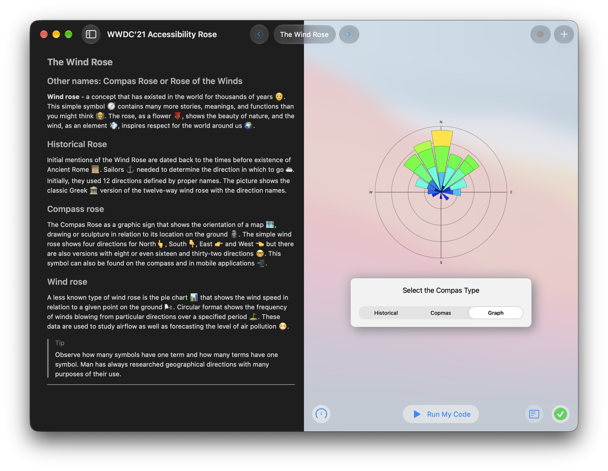
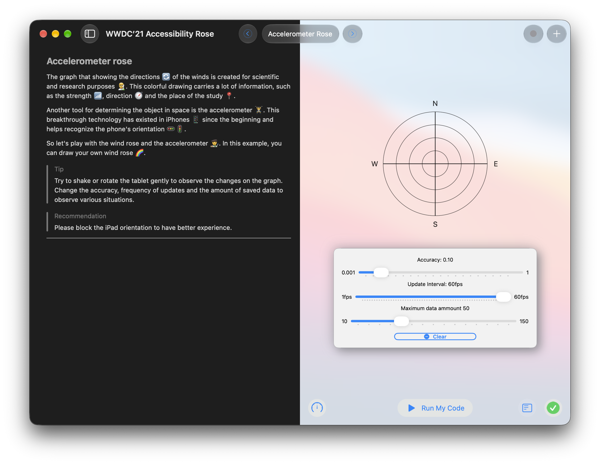
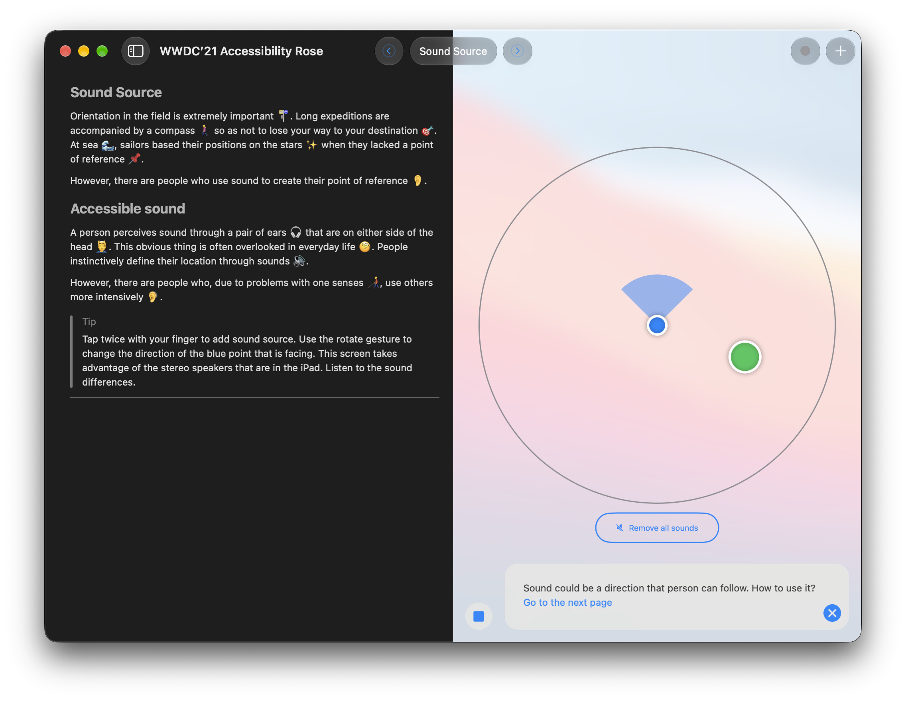
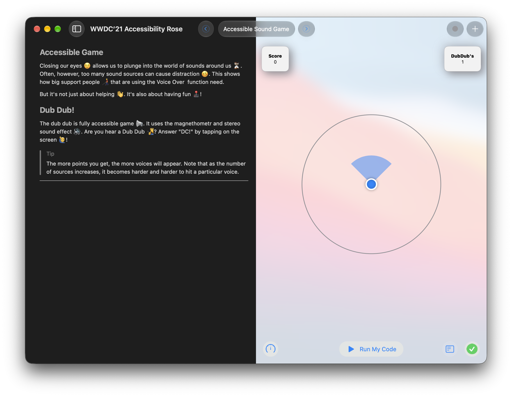
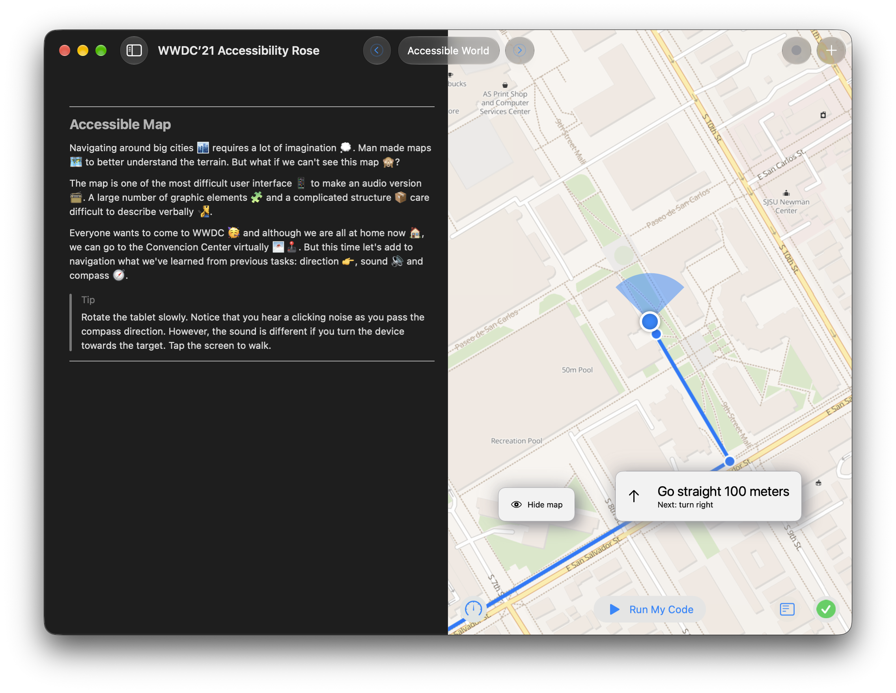

# WWDC21: Accessibility Rose

> My **WWDC 2021 Swift Student Challenge** winning submission: a SwiftUI Playground Book that follows one symbol, the wind (compass) rose, from history to accessible navigation by sound.

Five interactive pages:

1. **The Wind Rose**: the historical, compass and wind-chart versions of one symbol.
2. **Accelerometer Rose**: draw your own wind rose from live accelerometer data; tweak accuracy, update frequency and history length.
3. **Sound Source**: place sound sources on a plane and hear them in stereo; rotate the listener to hear direction change.
4. **Accessible Sound Game**: the game "Dub Dub!". Find the voice by ear using the magnetometer and stereo panning, answer "DC!" with a tap. More voices appear as you score.
5. **Accessible Map**: walk a virtual WWDC Convention Center using what the previous pages built: direction, sound and a compass that clicks as you turn.

The idea: a map is one of the hardest interfaces to make audible, so the book builds the pieces (heading, spatial sound, feedback) step by step.

## Demo

▶ [Watch the demo on YouTube](https://www.youtube.com/watch?v=V9o_sMwLuaU)

## Screenshots

<table>
  <tr>
    <td><b>1 · The Wind Rose</b> 
      </td>
    <td><b>2 · Accelerometer Rose</b> 
      </td>
  </tr>
  <tr>
    <td><b>3 · Sound Source</b> 
      </td>
    <td><b>4 · Accessible Sound Game</b> 
      </td>
  </tr>
  <tr>
    <td><b>5 · Accessible Map</b> 
      </td>
  </tr>
</table>

## What's inside

A Swift Playground Book with a `Core` module written in SwiftUI, with AVFoundation for audio and CoreMotion for sensors:

- `Page 1` to `Page 5`: one folder per page (compass models, motion manager, audio player and speaker, game, location/navigation)
- `Common`: shared background and view container
- Sound effects in `PrivateResources` (the game is designed to be playable without looking at the screen)

## Run it

Open `WWDC’21 Accessibility Rose.playgroundbook` in **Swift Playgrounds on iPad** (AirDrop or the Files app). Use a real iPad (pages 2-5 rely on motion sensors and stereo speakers) and lock the iPad orientation as recommended on page 2.

Built for Swift Playgrounds 3.4+ (Swift 5.3). Newer versions of the app may no longer open the legacy `.playgroundbook` format.
